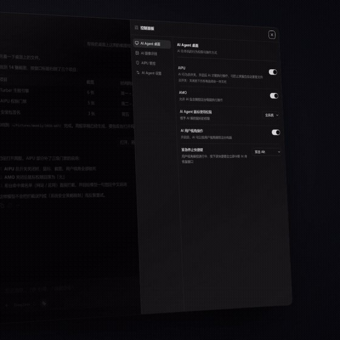
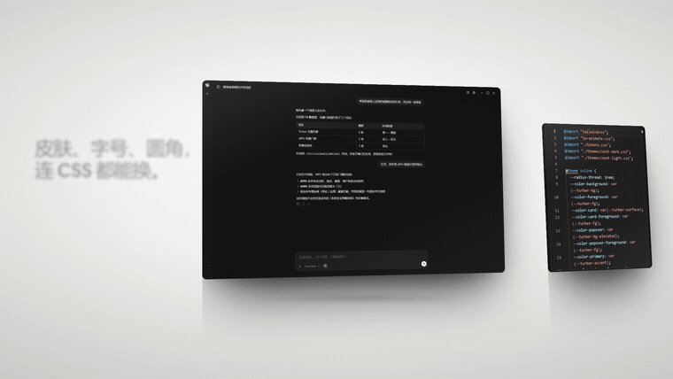

<div align="center">


# Turber

**A local-first desktop AI client that can actually drive your computer.**

[](https://github.com/Yamiabab/Turber/releases)
[](https://tauri.app)
[](https://react.dev)
[](https://www.rust-lang.org)
[](./LICENSE)
[](#platform-support)

**[Download](https://github.com/Yamiabab/Turber/releases)** ·
[简体中文](./README.zh-CN.md) ·
[How it works](#how-it-works) ·
[Safety model](#safety-model)

</div>

Turber is a desktop AI workbench that runs entirely on your own machine. It reads your screen, moves the mouse and types on the keyboard — the same way you do — while conversations, settings and themes stay in a local SQLite file. Models come from a local Ollama instance or any OpenAI-compatible endpoint.



## Why it exists

Cloud computer-use agents are impressive, but every step of every task sends a screenshot of your desktop to someone else's server, and every click is billed per token. Turber takes the opposite approach: the loop runs on your machine, against a model you choose, and the screen never leaves the device.

## What it does

**It drives the desktop, not a browser tab.** Screen capture goes through GDI `BitBlt`, and clicks and keystrokes go through `SendInput` — so it works with native Windows applications, not just websites.

**It sees the screen.** Each step captures the desktop, encodes it as JPEG, and sends it to a vision-capable model. A foreground-window check keeps the model from acting on the wrong app.

**It stops the moment you say so.** Double-tap `Alt` and every pending action is cancelled immediately.

## How it works

```
prompt → reasoning → screenshot → tool call → SendInput → look again → repeat
```

1. The model gets a system prompt describing the desktop and the available tools.
2. It calls tools like `get_desktop_photo`, `mouse_goto`, `mouse_click_left`, `keyboard_type_text`, `open_url`.
3. Rust executes them locally and returns the result, including a fresh screenshot.
4. The loop repeats for up to 12 rounds, then hands control back to you.

Models that do not support native tool calling fall back to a plain-text protocol, so small local models still work.

## Safety model

Anything that can move your mouse can also click the wrong thing, so the permissions are layered and each layer depends on the one above it:

| Layer | What it gates |
| --- | --- |
| **AIPU** | Master switch. Off means nothing else can be enabled. |
| **AMO** | Autonomous operation. Off drops mouse permission back to `none`. |
| **Mouse permission** | `none` or `system-wide`. |
| **Screen capture** | Required before user-view operation. |
| **Blocklist** | Matching sites or apps are refused before any action runs. |
| **Emergency stop** | Double-tap `Alt` cancels everything in flight. |

When a blocklist entry matches, the model receives an explicit refusal message instead of a generic error, so it does not retry the same action in a loop.



## Compared with cloud agents

| | Cloud computer-use agents | Turber |
| --- | --- | --- |
| Where it runs | Vendor's cloud environment | Your own desktop session |
| Screen contents | Uploaded to a server | Never leave the device |
| Model | Fixed by the vendor | Any OpenAI-compatible endpoint or local Ollama |
| Cost per task | Billed per token | $0 with a local model |
| Permission control | Vendor policy | Local switches, blocklist and hotkey |
| Native Windows apps | Varies | Yes, through `SendInput` |

## Features

- **Local-first** — conversations, settings and themes persist to SQLite (`rusqlite`) with no account required.
- **Multiple model backends** — Ollama and OpenAI-compatible providers ship built in; switching is one line of config.
- **Themeable** — light/dark presets, radius and font density, plus a Monaco-powered editor for raw CSS overrides that apply instantly.
- **Thread management** — create, rename and delete threads, with streaming message rendering (`assistant-ui` + `assistant-stream`).
- **Bilingual UI** — every string runs through i18n and can switch between English and Chinese at runtime.
- **Built-in file tools** — browse, read, write and search the local filesystem, with a deny list for system directories.

## Quick start

Requirements: Node.js >= 20, stable Rust, and the [Tauri 2 prerequisites](https://tauri.app/start/prerequisites/).

```bash
npm install
npm run tauri dev      # desktop app with Rust hot reload
npm run build          # type check + frontend bundle
npm run tauri build    # installer for the current platform
```

Point it at a model in **Settings → API**. The defaults are:

- Ollama — `http://localhost:11434/v1`
- DeepSeek — `https://api.deepseek.com/v1`
- Any other OpenAI-compatible endpoint

## Platform support

Computer control is **Windows-only** today: `src-tauri/src/screen.rs` uses GDI and `SendInput`, and other platforms compile against stubs. The UI itself runs everywhere Tauri does.

## Project structure

```
src/
├── components/         # layout, chat, settings, control panel, user-view guard
├── core/
│   ├── ai/             # providers, desktop tools, prompts, AIPU guard
│   ├── i18n/           # English and Chinese copy
│   ├── store/          # Zustand state and thread repositories
│   └── theme/          # theme engine and style overrides
├── pages/              # page-level composition
└── styles/             # global styles and theme variables
src-tauri/src/
├── ai.rs               # streaming chat, request cancellation
├── screen.rs           # capture, input injection, emergency stop
├── store.rs            # SQLite persistence
├── ide.rs              # local file tools
└── lib.rs              # command registration
server/                 # optional local account service (Node 22)
docs/media/             # README assets
```

## Building and releases

`npm run tauri build` produces an installer for the current platform.

Releases are built in CI: pushing a `v*` tag runs [`.github/workflows/release.yml`](./.github/workflows/release.yml), which builds the NSIS installer, signs it, and publishes it to [Releases](https://github.com/Yamiabab/Turber/releases). The workflow can also be triggered manually with a version number.

## Tech stack

| Layer | Choice |
| --- | --- |
| Desktop shell | Tauri 2 (Rust, `rusqlite` / `reqwest` / `windows-rs`) |
| Frontend | React 19 + TypeScript + Vite |
| Styling | Tailwind CSS 4 + Radix UI + custom theme engine |
| Chat | `assistant-ui` + `assistant-stream` + Lexical + Monaco |
| State | Zustand |
| Account service | Node.js 22 + `node:sqlite` |

## Contributors

<table>
  <tr>
    <td align="center">
      <a href="https://github.com/Yamiabab">
        <br />
        <sub><b>Yamiabab</b></sub>
      </a>
    </td>
    <td align="center">
      <a href="https://github.com/Claude">
        <br />
        <sub><b>Claude</b></sub>
      </a>
    </td>
  </tr>
</table>

## License

Released under the [GNU Affero General Public License v3.0](./LICENSE).

You may use, modify and redistribute this software. If you distribute a modified version, or make one available over a network, you must release the complete corresponding source under AGPL-3.0 and keep the copyright notices. Commercial closed-source use requires a separate license.
