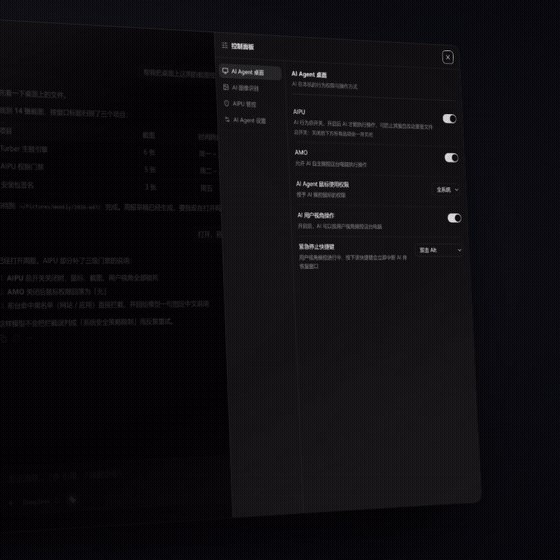
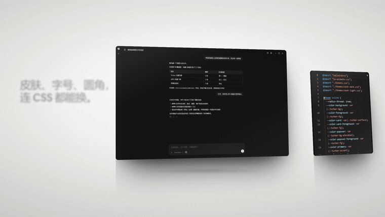

<div align="center">


# Turber

**本地运行、能真正操作你电脑的桌面 AI 客户端**

[](https://github.com/Yamiabab/Turber/releases)
[](https://tauri.app)
[](https://react.dev)
[](./LICENSE)
[](#平台支持)

**[下载安装包](https://github.com/Yamiabab/Turber/releases)** · [English](./README.md)

</div>

Turber 是一个完全跑在本机的桌面 AI 工作台。它能看你的屏幕、移动鼠标、敲键盘——和你自己操作的方式一样——而对话、设置、皮肤都存在本地 SQLite 里。模型可以接本地 Ollama，也可以接任何 OpenAI 兼容接口。



## 它和云端方案的区别

云端的 computer-use 智能体很强，但每一步操作都要把桌面截图传到别人的服务器，每一次点击都按 token 计费。Turber 走反方向：整个循环在你机器上跑，模型你自己选，屏幕不出本机。

## 它能做什么

**操作的是桌面，不是浏览器标签页。** 截图走 GDI `BitBlt`，点击和按键走 `SendInput`，所以原生 Windows 应用也能用，不只限于网页。

**它看得见屏幕。** 每一步都会截屏、编码成 JPEG、交给有视觉能力的模型；同时检查前台窗口，避免模型对着错误的程序乱点。

**你喊停，它立刻停。** 双击 `Alt`，所有进行中的操作立即取消。

## 安全模型

能移动鼠标的东西，也可能点错东西，所以权限是一层压一层的：

| 层级 | 作用 |
| --- | --- |
| **AIPU** | 总开关，关闭后其余选项全部不可用 |
| **AMO** | 自主操控，关闭后鼠标权限回落为「无」 |
| **鼠标权限** | 无 / 全系统 |
| **截取桌面** | 开启后才能进行用户视角操作 |
| **黑名单** | 命中的网站或应用在执行前就被拒绝 |
| **紧急停止** | 双击 `Alt` 取消所有进行中的动作 |

命中黑名单时，模型收到的是一句明确的拒绝说明，而不是笼统的报错——这样它不会反复重试同一个动作。



## 快速开始

环境要求：Node.js >= 20、stable Rust、[Tauri 2 系统依赖](https://tauri.app/start/prerequisites/)。

```bash
npm install
npm run tauri dev      # 带 Rust 热重载的桌面端
npm run build          # 类型检查 + 前端打包
npm run tauri build    # 打当前平台的安装包
```

在 **设置 → API** 里选模型，预置了 Ollama（`http://localhost:11434/v1`）、DeepSeek、OpenAI、Moonshot、SiliconFlow，也可以填任意 OpenAI 兼容地址。

## 平台支持

**操作电脑的能力目前仅支持 Windows**：`src-tauri/src/screen.rs` 用的是 GDI 和 `SendInput`，其他平台编译时走空实现。界面本身在 Tauri 支持的平台上都能跑。

## 主要特性

- **本地优先** — 会话、设置、主题全部落盘到 SQLite（`rusqlite`），不需要账号
- **多模型后端** — 内置 Ollama 和 OpenAI 兼容协议，换模型只改一行配置
- **可换肤** — 深浅色预设、圆角与字号密度，外加 Monaco 编辑的原始 CSS 覆盖，改完即时生效
- **多会话管理** — 新建、重命名、删除，流式消息渲染
- **中英双语** — 所有文案走 i18n，运行时切换
- **本地文件工具** — 浏览、读写、搜索本机文件，系统目录有写入黑名单

## 目录结构

```
src/                    # 前端（React 19 + TypeScript）
├── components/         # 布局、聊天、设置、控制面板、用户视角守卫
├── core/ai/            # 模型供应商、桌面工具、提示词、AIPU 拦截
├── core/store/         # Zustand 状态与会话仓库
└── core/theme/         # 主题引擎与样式覆盖
src-tauri/src/
├── ai.rs               # 流式对话、请求取消
├── screen.rs           # 截图、输入注入、紧急停止
├── store.rs            # SQLite 持久化
├── ide.rs              # 本地文件工具
└── lib.rs              # 命令注册
server/                 # 可选的本地账号服务（Node 22）
docs/media/             # README 素材
```

## 构建与发布

`npm run tauri build` 会打出当前平台的安装包。

正式发布走 CI：推送 `v*` 标签会触发 [`.github/workflows/release.yml`](./.github/workflows/release.yml)，自动构建 NSIS 安装包、签名并发布到 [Releases](https://github.com/Yamiabab/Turber/releases)。也可以在 Actions 里手动触发并指定版本号。

## 技术栈

| 层 | 选型 |
| --- | --- |
| 桌面外壳 | Tauri 2（Rust，`rusqlite` / `reqwest` / `windows-rs`） |
| 前端 | React 19 + TypeScript + Vite |
| 样式 | Tailwind CSS 4 + Radix UI + 自研主题引擎 |
| 聊天 | `assistant-ui` + `assistant-stream` + Lexical + Monaco |
| 状态 | Zustand |
| 账号服务 | Node.js 22 + `node:sqlite` |

## 许可

采用 [GNU Affero General Public License v3.0](./LICENSE)。

你可以使用、修改、再分发。如果分发修改版，或通过网络提供修改版服务，必须以 AGPL-3.0 公开完整对应源码并保留版权声明。闭源商用需要单独授权。
